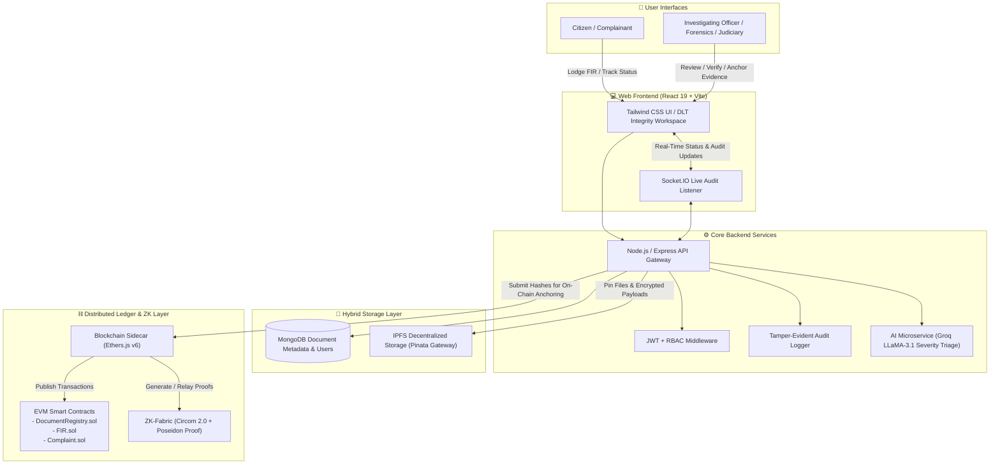
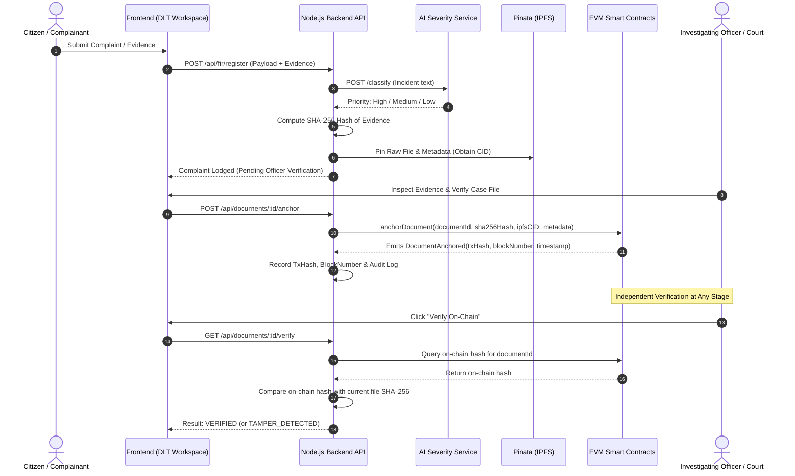

# ⚖️ JusticeChain

> **DLT-Based Chain of Custody & Tamper-Evident Integrity System for Legal & Investigation Records**  
> Enterprise-grade decentralized infrastructure for law enforcement, digital forensics, and judiciary record management.

---

[](https://ethereum.org/)
[](https://iden3.io/)
[](https://soliditylang.org/)
[](https://nodejs.org/)
[](./LICENSE)

---

## 📌 Executive Summary

In traditional criminal justice and policing systems, records such as **First Information Reports (FIRs)**, forensic case files, witness statements, and evidence logs are prone to custodial tampering, post-facto alteration, date-backdating, and unauthorized deletions. Centralized databases cannot guarantee an incorruptible chain of custody because database administrators or compromised credentials can silently manipulate records.

**JusticeChain** leverages **Distributed Ledger Technology (DLT)** to establish an immutable, verifiable, and transparent chain of custody for legal and investigative records. By anchoring SHA-256 document cryptographic hashes and state changes directly onto smart contracts on an EVM-compatible distributed ledger, combined with decentralized content addressing via **IPFS** and privacy-preserving **Zero-Knowledge (ZK) proofs**, JusticeChain ensures that:
- Every record is cryptographically provable from the exact second it is lodged.
- Any unauthorized post-registration change triggers an immediate cryptographic mismatch alert.
- Custodial transitions (Complainant $\rightarrow$ Investigating Officer $\rightarrow$ Forensic Examiner $\rightarrow$ Public Prosecutor $\rightarrow$ Magistrate) are permanently recorded on the ledger.

---

## 🎯 Key Architectural Objectives & DLT Capabilities

| Core Capability | How JusticeChain Delivers |
|---|---|
| **Distributed Ledger Application** | Uses EVM smart contracts (`DocumentRegistry.sol`, `FIR.sol`, `Complaint.sol`) to anchor hashes, timestamps, and custodial state transitions immutably. |
| **Tamper-Evident Chain of Custody** | Cryptographic fingerprinting (SHA-256) anchored on-chain with independent verification via `GET /api/documents/:id/verify`. |
| **Privacy & Confidentiality** | Off-chain encrypted storage + IPFS decentralized pinning + **Circom 2.0 ZK-SNARK circuit** (`fir_proof.circom`) with Poseidon hashing to verify document validity without exposing complainant PII. |
| **Multi-Stakeholder Governance** | Departmental Role-Based Access Control (RBAC) ensuring checks-and-balances across Investigation, Forensics, Prosecution, and Judiciary. |
| **AI-Assisted Operational Triage** | LLaMA-3.1 powered inference server for automated incident severity classification (High / Medium / Low). |

---

## 🏛️ System Architecture



---

## 🔄 Core DLT Workflow: Chain of Custody



---

## ✨ Key Features & Technical Highlights

### 1. DLT Document Anchoring & Verification
- **SHA-256 Cryptographic Fingerprint:** Every uploaded file is hashed at the byte level before indexing.
- **On-Chain Attestation:** Hashes and IPFS CIDs are anchored directly to `DocumentRegistry.sol` on an EVM-compatible ledger.
- **Zero-Trust Verification:** The `GET /api/documents/:id/verify` endpoint verifies stored hashes against on-chain smart contract state, instantly detecting any custodial or database-level tampering.

### 2. Privacy-Preserving Zero-Knowledge Layer (ZK-Fabric)
- **Circom 2.0 Circuit (`fir_proof.circom`):** Uses Poseidon hash commitments to generate ZK proofs.
- **Selective Disclosure:** Proves that an authentic FIR was lodged and committed at a specific block height without exposing sensitive victim identities or private details in public ledger logs.

### 3. Hierarchical Multi-Departmental RBAC
Strict separation of powers matching legal and police department workflows:
- **Investigating Officer (IO):** Records evidence, files charge sheets, requests forensic tests.
- **Station House Officer (SHO):** Reviews, approves, and anchors FIRs onto the blockchain.
- **Forensic Examiner:** Attaches cryptographically signed forensic reports.
- **Public Prosecutor / Legal Counsel:** Accesses verified case dossiers for court presentation.
- **Judiciary / Magistrate:** Conducts independent verification of case file custody timelines.
- **Citizen / Complainant:** Tracks progress with transparent, tamper-proof milestone updates.

### 4. AI-Powered Crime Severity Triage
- Automated NLP classification powered by **Groq / LLaMA-3.1** classifying incidents into **High**, **Medium**, or **Low** priority to assist law enforcement in emergency dispatch and rapid review.

### 5. Real-Time Event Bus & Audit Trail
- Integrated **Socket.IO** server broadcasting live FIR status transitions, blockchain confirmations, and custodial transfers.

---

## 🛠️ Technology Stack

| Layer | Technology | Purpose |
|---|---|---|
| **Frontend** | React 19, Vite, Tailwind CSS v4 | Responsive, accessible DLT workspace UI |
| **Real-time Client** | Socket.IO Client, React Hot Toast | Live event streaming & status alerts |
| **Backend API** | Node.js, Express 5, MongoDB / Mongoose | Primary business logic, REST API, & authentication |
| **Blockchain Sidecar**| Node.js, Express, Ethers.js v6 | Web3 gateway interfacing with smart contracts |
| **Smart Contracts** | Solidity (`^0.8.x`), Hardhat / EVM | `DocumentRegistry.sol`, `FIR.sol`, `Complaint.sol` |
| **Decentralized Storage**| IPFS (Pinata SDK) | Tamper-resistant, content-addressed off-chain file storage |
| **Zero-Knowledge** | Circom 2.0, SnarkJS, Poseidon | Privacy-preserving validity proofs for FIRs |
| **AI Classification** | Python 3, Flask, Groq (`llama-3.1-8b-instant`) | Incident severity triage & priority routing |

---

## 📂 Repository Structure

```text
JusticeChain/
├── AI/                          # Python Flask AI Severity Classification Microservice
│   ├── connect.py               # Groq LLaMA-3.1 inference service
│   ├── requirements.txt         # Python dependencies (Flask, groq, etc.)
│   └── .env.example             # AI environment template
├── backend/                     # Primary Node.js / Express REST API
│   ├── controllers/             # Document, FIR, Auth, Case controllers
│   ├── middleware/              # JWT verification & RBAC authorization
│   ├── models/                  # Mongoose schemas (FIR, Document, User, AuditLog)
│   ├── routes/                  # Express routes (/api/documents, /api/fir, /api/auth)
│   ├── utils/                   # IPFS helper, PDF generation, cryptographic hashing
│   ├── .env.example             # Backend environment template
│   └── index.js                 # API server entrypoint with Socket.IO
├── blockchainbackend/           # Web3 / DLT Microservice
│   ├── JusticeChainABI.json     # Smart contract ABIs
│   ├── DocumentRegistryABI.json
│   ├── ComplaintABI.json
│   ├── index.js                 # Ethers.js interaction service
│   └── .env.example             # Blockchain RPC & wallet private key template
├── contracts/                   # Solidity Smart Contracts
│   ├── DocumentRegistry.sol     # Document hash anchoring & chain of custody
│   ├── FIR.sol                  # FIR registration & state machine
│   └── Complaint.sol            # Public citizen complaint ledger
├── frontend/                    # React 19 Frontend Web Application
│   ├── src/
│   │   ├── components/          # Navbar, Footer, Homepage, UI cards
│   │   ├── pages/               # DLT Prototype Workspace, Admin Dashboard, File FIR
│   │   └── utils/               # Auth, API client, local storage fallbacks
│   ├── index.html
│   └── vite.config.js
├── zk-fabric/                   # Zero-Knowledge Circuit & Relayer
│   ├── circuit/                 # fir_proof.circom Poseidon hash circuit
│   └── relayer/                 # Proof verification and relayer bridge
├── package.json                 # Monorepo scripts (concurrent dev execution)
└── README.md                    # Project documentation
```

---

## 🚀 Getting Started

### Prerequisites

Ensure you have installed:
- **Node.js**: v18.0.0 or higher (v20+ recommended)
- **npm**: v9.0.0 or higher
- **Python**: 3.9+ (for the AI microservice)
- **MongoDB**: Local daemon running on `mongodb://localhost:27017` or a MongoDB Atlas URI
- **Git**

---

### Step 1: Clone and Install Dependencies

```bash
# Clone the repository
git clone https://github.com/codelawyer-max/JusticeChain.git
cd JusticeChain

# Install all sub-project dependencies in one command
npm run install:all
```

---

### Step 2: Configure Environment Variables

#### 1. Main Backend (`backend/.env`)
Copy the template and fill in your credentials:
```bash
cp backend/.env.example backend/.env
```
Key variables:
```env
PORT=5000
FRONTEND_URL=http://localhost:5173
MONGO_URL=mongodb://localhost:27017/justicechain
JWT_SECRET=your_super_secret_jwt_key
PINATA_API_KEY=your_pinata_api_key
PINATA_SECRET_API_KEY=your_pinata_secret_key
BLOCKCHAIN_BACKEND_URL=http://localhost:3000
AI_SERVICE_URL=http://127.0.0.1:5050
```

#### 2. Blockchain Backend (`blockchainbackend/.env`)
```bash
cp blockchainbackend/.env.example blockchainbackend/.env
```
Key variables:
```env
PORT=3000
RPC_URL=https://sepolia.infura.io/v3/your_infura_project_id
PRIVATE_KEY=your_testnet_wallet_private_key
CONTRACT_ADDRESS=0xYourDeployedFIRContractAddress
DOCUMENT_CONTRACT_ADDRESS=0xYourDeployedDocumentRegistryAddress
PINATA_API_KEY=your_pinata_api_key
PINATA_SECRET_API_KEY=your_pinata_secret_key
```

#### 3. AI Microservice (`AI/.env`)
```bash
cp AI/.env.example AI/.env
```
Key variable:
```env
GROQ_API_KEY=gsk_your_groq_api_key_here
```

---

### Step 3: Run the Application

You can start the frontend and backend concurrently with:

```bash
# Start frontend (:5173) and backend (:5000)
npm run dev
```

#### Starting Supporting Microservices:

- **Blockchain Microservice (:3000):**
  ```bash
  npm run dev:blockchain
  ```

- **AI Classification Service (:5050):**
  ```bash
  cd AI
  python3 -m venv venv
  source venv/bin/activate    # On Windows: venv\Scripts\activate
  pip install -r requirements.txt
  python connect.py
  ```

Access the application in your browser at: **`http://localhost:5173`**

---

## 📡 API Reference Overview

### Document & DLT Integrity
| Method | Endpoint | Description | Auth Required |
|---|---|---|---|
| `POST` | `/api/documents/upload` | Upload evidence file, compute SHA-256 & pin to IPFS | Yes (Officer) |
| `POST` | `/api/documents/:id/anchor` | Commit document hash and CID to EVM smart contract | Yes (Officer / Admin) |
| `GET` | `/api/documents/:id/verify` | Fetch on-chain hash and compare against stored SHA-256 | Yes |
| `GET` | `/api/documents` | Fetch documents with pagination and role filtering | Yes |
| `GET` | `/api/documents/:id` | Fetch specific document details and audit trail | Yes |

### FIR & Case Management
| Method | Endpoint | Description | Auth Required |
|---|---|---|---|
| `POST` | `/api/fir/register` | Lodge a new FIR (triggers AI triage and hash generation) | Public / Citizen |
| `GET` | `/api/fir/track/:firNumber`| Public status lookup for complainants | Public |
| `GET` | `/api/fir/admin` | Fetch all FIRs for officer dashboard (with pagination) | Yes (Admin / Officer) |
| `PUT` | `/api/fir/status/:id` | Update case status and broadcast on Socket.IO | Yes (Officer) |

### AI Triage
| Method | Endpoint | Description | Auth Required |
|---|---|---|---|
| `POST` | `/classify` | Classify incident severity into High, Medium, or Low | Internal (Port 5050) |

---

## 📜 Legal & Regulatory Compliance

- **Indian Evidence Act & Bharatiya Sakshya Adhiniyam (BSA), 2023:**
  Section 65B requires electronic evidence to be accompanied by a certificate proving that the electronic record remained unaltered from creation through custody transfer. JusticeChain provides mathematical verification through immutable on-chain block timestamps and cryptographic hashes.
- **Data Protection (DPDP Act, 2023):**
  Personally Identifiable Information (PII) is kept off-chain in encrypted storage. Only pseudonymous hashes, Zero-Knowledge commitments, and non-sensitive metadata are broadcast to the distributed ledger.

---

## 🔮 Future Roadmap

- [ ] **Federated e-Courts Integration:** Direct cryptographic dossier export for Indian e-Courts interoperability.
- [ ] **Account Abstraction (ERC-4337):** Gasless transactions for citizen complaint filings sponsored via Paymasters.
- [ ] **Mobile Officer App:** Biometrically authenticated field evidence capture with instant device-level SHA-256 signing.
- [ ] **CCTNS Interoperability:** Bridging state police databases with verifiable DLT notary checkpoints.

---

## 👥 Project Information & Acknowledgements

Developed and maintained by the JusticeChain project contributors.

- **Repository:** [codelawyer-max/JusticeChain](https://github.com/codelawyer-max/JusticeChain)
- **License:** Open source under the [ISC License](LICENSE).
